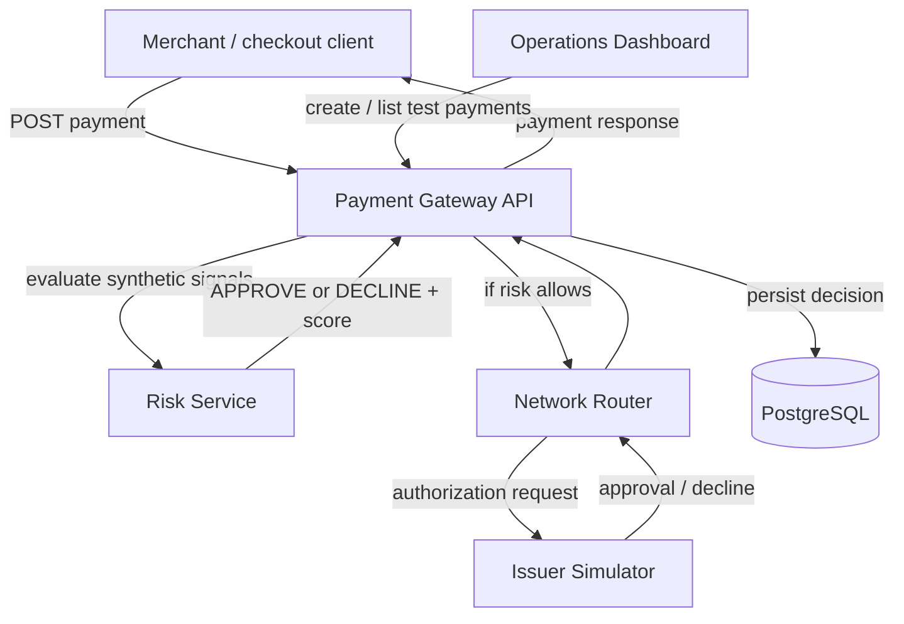

# CardRail architecture

CardRail is an educational payment-processing simulation. It is not a real payment gateway or card network and must never receive real cardholder data.

## Request flow



## Component responsibilities

- **Merchant / checkout client:** represents an ecommerce backend. It calls the gateway API; in this milestone, curl can act as the merchant client.
- **Payment Gateway API:** validates requests, accepts an idempotency key, orchestrates risk and authorization, stores the final decision, and returns the result.
- **Risk Service:** applies transparent, deterministic synthetic rules. This is a teaching aid, not a fraud detection model.
- **Network Router:** represents routing and message forwarding between gateway and issuer. It adds a simulated route and network reference.
- **Issuer Simulator:** returns a synthetic authorization decision. The dashboard's approve/decline scenario is a test instruction, not an actual bank decision.
- **PostgreSQL:** durable store for the final payment result, idempotency key, risk score, route, and issuer reference.
- **Operations Dashboard:** internal operator/testing UI; it is not the customer checkout.

## Important limitations in this milestone

- Authorization is synchronous and uses HTTP calls; Kafka/event-driven processing comes in a later milestone.
- Capture, clearing, settlement, refunds, reconciliation, tokenization, 3-D Secure, and real acquiring/network connectivity are not implemented yet.
- Risk scoring is deterministic and intentionally simple.
- Idempotency keys prevent duplicate inserts for requests that have already completed; concurrent requests with the same key need stronger in-flight coordination before production-like claims.
- A dependency failure returns HTTP 503. The current API does not persist an intermediate PENDING state or implement automatic retries.
- This is not production-grade or PCI-certified software.

## Local runtime

Use Docker Compose for the complete stack. Service-to-service URLs are provided by Compose DNS. The dashboard is available at `http://localhost:5173`; the API is available at `http://localhost:3000`.

## Test the flow

```bash
curl -sS -X POST http://localhost:3000/api/payments \
  -H 'Content-Type: application/json' \
  -H 'Idempotency-Key: demo-payment-001' \
  -d '{"amount":125.50,"currency":"USD","merchantId":"merchant-demo","scenario":"approve"}'

curl -sS http://localhost:3000/api/payments
```

Test a synthetic risk rejection using a marker merchant ID:

```bash
curl -sS -X POST http://localhost:3000/api/payments \
  -H 'Content-Type: application/json' \
  -H 'Idempotency-Key: demo-risk-reject-001' \
  -d '{"amount":125.50,"currency":"USD","merchantId":"risk-demo","scenario":"approve"}'
```

The risk service adds a large score for merchant IDs beginning with `risk-`, producing a simulated risk decline without routing to the issuer.
